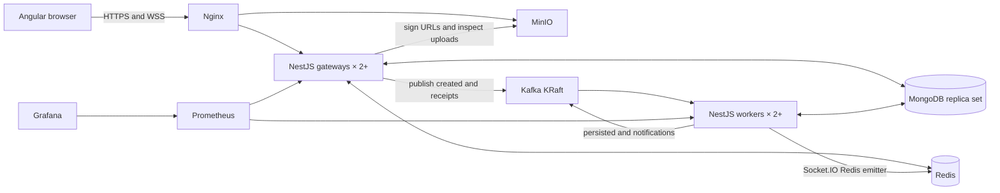
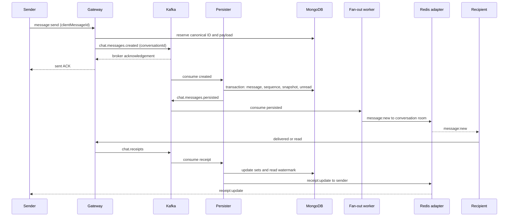

# Relay architecture

## Application structure

The NestJS entry point in `apps/api/src/main.ts` configures the HTTP adapter and starts the role selected by `AppModule`. `GatewayModule` mounts the REST controllers, HTTP guards and Socket.IO gateway. `WorkerModule` owns the Kafka consumer lifecycle. Both roles mount health and metrics, and the worker only exposes those endpoints. The seed command starts an application context containing the feature services it needs. Feature folders own their services, validation and persistence schemas. Shared model registrations are imported explicitly by features that query or update those collections. The message transaction still updates the message and conversation on the same MongoDB session.

The Angular entry point bootstraps a standalone application with providers in `app.config.ts` and lazy routes in `app.routes.ts`. The authenticated layout owns the socket and chat session lifecycle across chat and profile routes. The chat feature owns conversation and attachment data access, state and UI. Profile has its own API client. Cross-feature identity, user search, theme, notifications and socket transport live in `core`. Pure message state helpers and Angular unit tests live alongside the code they cover.

The workspace pins pnpm and enforces peer compatibility. Angular's test tooling uses Babel 7, and the OXC WASI fallback uses the emnapi versions accepted by its runtime. A small pnpm patch keeps KafkaJS 2.2.4 from scheduling another timer after its request queue empties. Recheck these compatibility pins when upgrading the affected tools.

## Kafka and delivery

| Topic                     | Partition key              | Consumer group          | Purpose                                               |
| ------------------------- | -------------------------- | ----------------------- | ----------------------------------------------------- |
| `chat.messages.created`   | Conversation ID            | `message-persister`     | Accepted client sends                                 |
| `chat.messages.persisted` | Conversation ID            | `message-fanout`        | Committed messages and recipient snapshot             |
| `chat.receipts`           | Conversation ID            | `message-receipts`      | Delivered and read changes                            |
| `chat.notifications`      | Conversation ID            | `message-notifications` | Idempotent offline message records                    |
| `chat.dlq`                | Source topic and partition | Operations tooling      | Source offset, correlation ID, and safe failure class |

The same conversation key preserves broker ordering within each topic. Cross-topic ordering is independent. The browser only sends a receipt for a persisted message, and the worker updates delivery sets with `$addToSet`. The client shows the greatest receipt stage it knows. For groups, a delivered or read tick indicates at least one recipient reached that stage.

A unique send reservation in MongoDB contains the canonical ObjectId, creation timestamp, payload and input fingerprint. Gateway retries reuse that event, including when acknowledgements are lost or a retry reaches a different gateway. A conflicting reuse of `clientMessageId` is rejected. Once the broker confirms the event, the gateway returns `sent`. The worker inserts the message and updates the conversation in one MongoDB transaction. It republishes the committed record on replay so a crash between MongoDB commit and Kafka publish recovers. Fan-out remains at-least-once. Browser merging and durable receipt sets handle repeated events.

Consumer workers use KafkaJS directly for explicit offset control. Nest's Kafka transport is used as the producer with `acks=-1`, idempotence, and one in-flight write per producer. Each consumer commits the next offset only after the record succeeds or is published to the DLQ. Processing retries three times with exponential backoff. If DLQ publication fails, the offset stays uncommitted. DLQ entries refer to the original broker position and omit message contents, tokens and attachments. Recovery tooling should redrive the referenced record while retained and preserve its original idempotency key. Changing partition count for existing live topics requires draining and a coordinated migration.

Public history cursors are message ObjectIds. The server resolves the cursor to a per-conversation committed sequence, which stays ordered even when several gateways assign IDs concurrently or an older reservation is finally published after a retry. Legacy rows without a sequence use their ObjectIds as the fallback order. The browser asks for `after=<lastMessageId>` on reconnect and reconciles the latest page so recent deletes and receipt changes converge. Older history is fetched with `before`. The database uses index bounds for all history pages.

## Redis keys

| Key                                                               | Type and retention                                           | Role                                                                                       |
| ----------------------------------------------------------------- | ------------------------------------------------------------ | ------------------------------------------------------------------------------------------ |
| `socket.io#*`, `socket.io-request#*`                              | Pub/sub                                                      | Adapter broadcast and room control across replicas                                         |
| `presence:user:{id}`                                              | Sorted set of socket IDs scored by heartbeat expiry; key TTL | Each device heartbeat renews only its own socket                                           |
| `presence:due`                                                    | Sorted set of users scored by latest socket expiry           | Sweeper reconciles abruptly lost gateways; final departure writes `lastSeenAt` to MongoDB  |
| `members:{conversationId}`, `members:version:{conversationId}`    | Set for 30s, generation for 90s                              | Cached membership with invalidation fencing. MongoDB authorizes durable changes.           |
| `profile:{id}`                                                    | JSON, 60s                                                    | Cache-aside public profile, invalidated on profile and last-seen updates                   |
| `conversations:recent:{userId}`, `conversations:version:{userId}` | JSON page for 12s, generation for 90s                        | First page of recent conversation summaries, fenced against stale fills after invalidation |
| `unread:{userId}:{conversationId}`                                | JSON number, 12s                                             | Read-through count populated from MongoDB, invalidated on writes                           |
| `typing:{conversationId}:{userId}`                                | String, 5s                                                   | Ephemeral typing state. Clients independently expire indicators.                           |
| `rate:*`                                                          | Sliding-window sorted set or throttler counter and block key | Per-user and per-IP limits with tighter auth and send limits                               |
| `auth:revoked:{sessionId}`                                        | String, refresh TTL                                          | Session denylist across gateway replicas                                                   |

Redis caches are expendable. MongoDB is authoritative for profiles, membership, unread counters, message history and rotating refresh sessions. Redis operations fail closed for authentication, socket rate limiting, and cached access checks during an outage.

## MongoDB

- **User** has unique normalized username and email, Argon2id password hash and public profile metadata.
- **Contact** has a unique owner and contact pair. Aliases are private to the owner.
- **Conversation** has a sparse unique sorted pair key for direct chats. Member records hold roles, read watermarks and unread counters. `(members.userId, updatedAt desc, _id desc)` supports recency paging with an ObjectId tie-breaker. The last-message snapshot keeps sidebar reads bounded.
- **Message** has a unique sender and client-message ID, an index on `(conversationId, _id desc)`, a sequence-aware history index, and a media-key index. Receipt fields store recipient IDs as sets. For-everyone deletion preserves a tombstone and removes visible content. Delete-for-me is user-scoped.
- **SendReservation** has a unique sender and client-message ID and stores the accepted event. It remains available for idempotent retries.
- **Session** stores the hash of the current refresh token and its expiry with a TTL index. Rotation is a MongoDB compare-and-swap. Reuse revokes the session, invalidates its access tokens and disconnects sockets in its session room across gateways.
- **Upload** binds a signed upload ticket to a user and conversation. It is retained for 24 hours. Sending a media message checks MinIO metadata and verifies the file signature for allowed raster images.
- **Notification** stores a unique user and message pair for offline processing. It expires after 30 days.

## Operations and scaling

Gateways accept WebSocket transport only, so an established connection stays on its upstream and reconnects can land anywhere. There is no Socket.IO polling request sequence that needs sticky load balancing. Nginx discovers gateway replicas through Docker DNS. Workers independently rebalance each topic group, with useful parallelism bounded by topic partitions and active conversations. Production Compose uses two gateways and two workers with health probes and bounded resource limits. Its bundled MongoDB, Kafka, Redis and MinIO are single-host, single-instance data services suitable for production-like verification.

For internet-facing deployment, provision a multi-member MongoDB replica set with authentication and TLS, a quorum-backed Kafka cluster with a replication factor of at least three, TLS and ACLs (the gateway and worker support SASL/PLAIN and SCRAM over TLS), a highly available Redis deployment with authentication, and replicated S3-compatible object storage. Keep these endpoints private and assign bucket-scoped application credentials. The bundled Compose config uses an isolated deployment network and plaintext Mongo/Redis/Kafka inside that network. It does not configure managed-provider credentials or replication for those services. Replace the bundled service definitions and dependencies in your deployment config when supplying managed endpoints. Run a supported and security-maintained S3 service for public deployments, since the bundled MinIO Community release is pinned for reproducible local testing. Set up backups, retention and alerts and validate restore and incident procedures against your environment.

For Kubernetes, use `/health/live` for liveness and `/health/ready` for readiness and startup. Scale gateways on CPU or connected sockets per pod and scale workers on committed consumer lag in addition to CPU. Allow time to drain WebSockets and Kafka consumers with a termination grace period of at least 40 seconds. Expose metrics on a private network with pod-level scraping. Run replica set, topic and bucket provisioning separately from workload rollouts.

| Failure                        | Behavior                                                                                                                           |
| ------------------------------ | ---------------------------------------------------------------------------------------------------------------------------------- |
| Kafka cannot confirm a produce | Gateway returns an error or the client times out. Retry uses the same canonical reservation.                                       |
| Redis unavailable              | New protected requests fail closed. At-least-once MongoDB writes remain replayable. Clients reconnect and backfill after recovery. |
| Worker stops mid-record        | Kafka reassigns the partition and replays from the last committed offset. Transactional inserts and receipt sets converge.         |
| MinIO unavailable              | Media operations and dependency readiness fail. A completed upload can be attached when MinIO recovers while its ticket is valid.  |
| Socket or gateway disappears   | Redis TTL and the presence sweeper clear the missing device. A reconnect pulls missed messages from MongoDB.                       |

Signed URLs are bearer capabilities until their short expiry. Revoking membership or deleting a message prevents new download tickets. Older signed URLs expire within two minutes. Unlinked uploads can leave orphaned objects after their Mongo ticket expires. Use inventory and an offline reconciliation process to remove unreferenced media in long-running installations. The message viewport uses fixed-size virtual rows with scrollable long bubbles to keep scroll offsets stable. Recent delete reconciliation is bounded to the latest fetched page.
